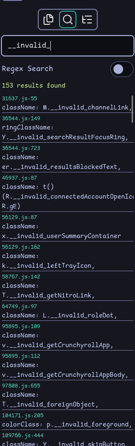

When all you have is a hammer, everything looks like a nail.[^1] When I write rust, I often find myself over-using [std::sync::mpsc](https://doc.rust-lang.org/std/sync/mpsc/)

## Build system plugins

A common form of code generation is [css modules](https://github.com/css-modules/css-modules). For the unfamiliar, css modules generate scoped css so class names don't collide across multiple files.

## Type checking

Type checking is important; however, because css modules are a build-time abstraction, and not something natively supported by typescript[^2]. This can lead, over time, to references to classes that don't exist. Take discord as an example. When rspack encounters a reference to a class that doesn't exist, it replaces the property access with `__invalid_` and leaves it at that. A quick search of `__invalid_` in discord's web bundle[^3] reveals that they have over 150 invalid references.

Full type checking for generated code would prevent this, catching errors like these before they ever effect anything.

## General scripts

[^1]: https://en.wikipedia.org/wiki/Law_of_the_instrument
[^2]: This is changing in typescript 7.1 with [content mappers](https://devblogs.microsoft.com/typescript/announcing-typescript-7-1-beta/#content-mappers)
[^3]: You can run your own searches on this exact same discord bundle [here](/e/view/791462a0fc55ed0127443fbb1d66aed0a4410971)